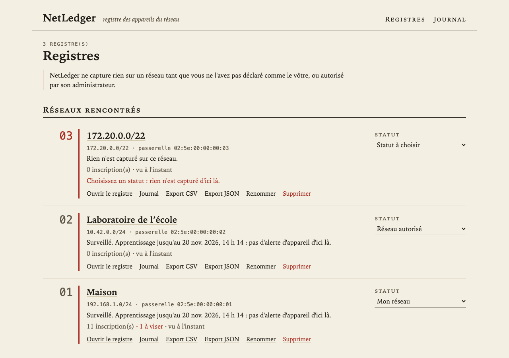
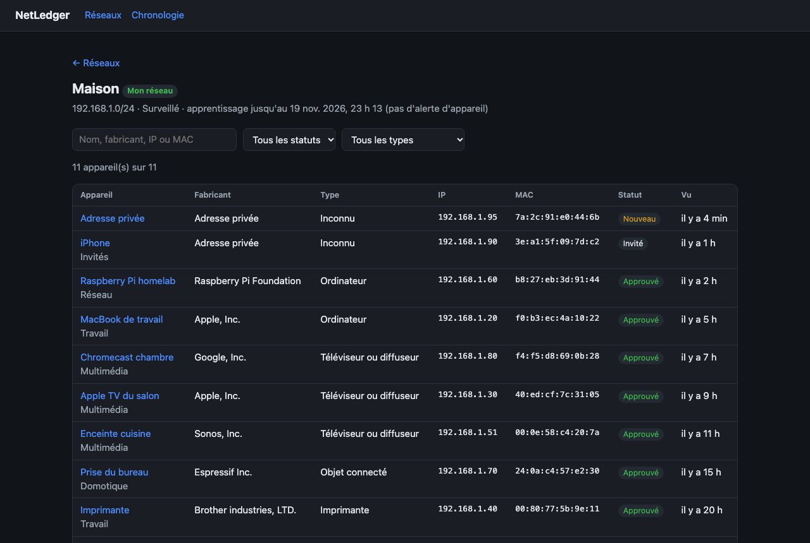
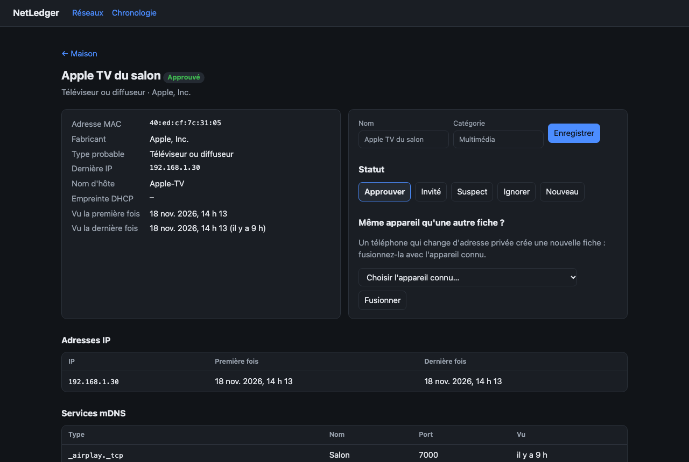
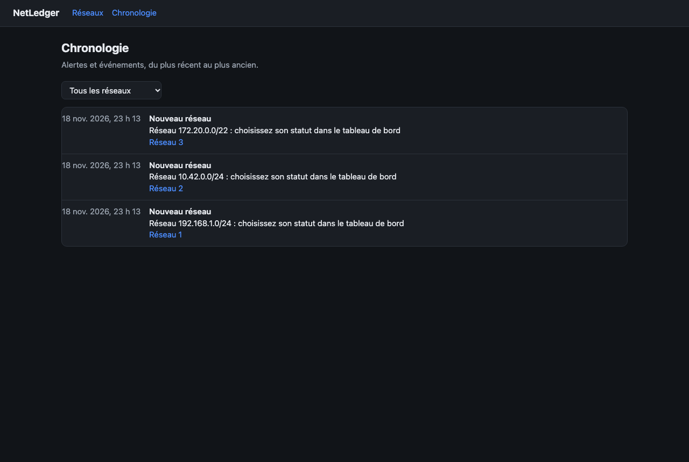
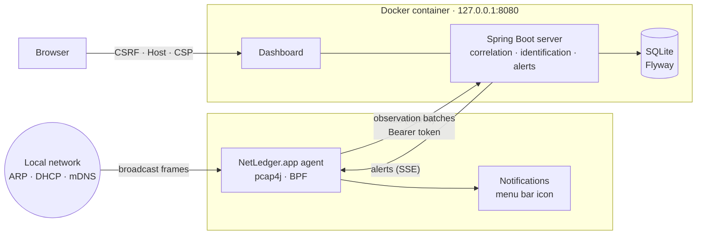

# NetLedger

[](https://github.com/Chakib-Selhi/NetLedger/actions/workflows/ci.yml)


[](LICENSE)

*[Version française](README.md)*

NetLedger keeps a ledger of the devices on the network your Mac is connected to. It listens to ARP, DHCP and mDNS traffic, identifies each device's vendor and probable type, keeps a per-network history, and warns you when an unknown device shows up.

> [!WARNING]
> **Authorized networks only.** NetLedger captures nothing until you declare the network as yours ("My network") or authorized by its administrator ("Authorized network"). Listening to a network without permission may be illegal. NetLedger is a defensive tool: passive listening, no port scanning, no interception, no ARP spoofing, no full packet stored. The active ARP sweep is off by default and limited to "My network".

## The problem

A home network holds dozens of devices: phones, computers, TVs, printers, smart plugs, guests' devices. The router shows a partial list, with no history and no alert. You cannot protect a device you don't know exists. NetLedger runs on the computer you already use, with no dedicated server and no online service.

## Screenshots

The screenshots come from the demo server (`./scripts/demo.sh start`): names and addresses are made up. The interface is in French.

| Networks and status | Devices of a network |
| --- | --- |
|  |  |

| Device page | Timeline |
| --- | --- |
|  |  |

## Architecture



**Why a native agent and a Docker server?** Docker Desktop runs containers in a Linux virtual machine. Even in host network mode, a container shares that VM's network, not the Mac's Wi-Fi card: it never sees the local network's ARP, DHCP and mDNS frames, and it cannot show a macOS notification. The work is split:

- **the agent** (`agent` module) is deliberately small: it captures, decodes, recognizes the current network, sends normalized observations and shows alerts. It never runs as administrator;
- **the server** (`server` module) holds all the business logic and is the only one writing to the database;
- **the `core` module** is shared: `Observation` model, decoders, JSON exchange format.

This sensor and server split keeps the privileged part small, as professional security tools do.

## Protocols

The agent reads only the fields it needs. The kernel BPF filter passes it nothing but `arp or (udp and (port 67 or port 68 or port 5353))`, in non-promiscuous mode.

- **ARP (RFC 826)**: every device asking for or announcing an IP address reveals its MAC and IP pair. Gratuitous ARP and RFC 5227 probes are enough to spot an arriving device. A reserved IP (the gateway, or an approved device in the last 24 hours) announced by another MAC raises a conflict alert, the classic sign of ARP spoofing.
- **DHCP (RFC 2131)**: the BOOTP header, then the options after the magic cookie: 12 (host name), 53 (message type), 55 (parameter request list, used as the system's **fingerprint**), 60 (vendor class) and 61 (client identifier). An iPhone returning to a known network may skip DHCP (DNAv4, RFC 4436): ARP and mDNS take over.
- **mDNS and DNS-SD (RFC 6762, 6763)**: PTR, SRV, TXT, A and AAAA records announce services (`_airplay._tcp`, `_ipp._tcp`…). The decoder guards name decompression: backward pointers only, at most 16 jumps, names of at most 255 bytes. The agent only asks mDNS questions (the service type enumeration, then a few types that identify a device: AirPlay, Cast, printers) and announces nothing: a full mDNS library would have published the Mac's name on the network.

**Identification**: the vendor comes from the IEEE registry (MA-L, MA-M, MA-S, longest prefix). An address with the "locally administered" bit set is a random **private address**: NetLedger shows "Adresse privée" instead of a vendor. The probable type follows deterministic rules, documented in [docs/identification.md](docs/identification.md).

## Security

- **Unprivileged agent**: access to the `/dev/bpf*` devices through the `access_bpf` group, as Wireshark does. Token stored in the macOS keychain.
- **Isolated server**: port published on `127.0.0.1` only, non-root user, read-only file system, no Linux capability, `no-new-privileges`, 300 MB of memory at most.
- **Agent API**: `Bearer` token compared in constant time (SHA-256 digests and `MessageDigest.isEqual`), bodies limited to 2 MB, errors without internal details.
- **Dashboard**: session-bound CSRF token, `SameSite=Strict` cookie, requests whose `Host` header is not a loopback name are refused (against DNS rebinding), strict content security policy (`script-src 'self'`). Host names coming from the network are rendered as text, never as HTML, and neutralized in the CSV export so a spreadsheet does not run them as formulas.
- **No AI, no online service**: the one exception is the IEEE vendor registry, downloaded monthly by the server.

## Installation

Requirements: an Apple Silicon Mac on macOS 13 or later, Docker Desktop, and a JDK 21 to build the agent.

1. **Capture access**, once: `brew install --cask wireshark-chmodbpf`, then log out and back in. Your account joins the `access_bpf` group.
2. **Shared token and server**:
   ```bash
   ./scripts/generate-token.sh
   docker compose up -d
   ```
3. **Token in the keychain**: `./scripts/install-agent-token.sh` (paste the token from `.env`).
4. **Agent**: `./scripts/package-agent.sh` builds `agent/target/dist/NetLedger-1.0.0.dmg`. Open it and drag NetLedger to Applications.
5. **Launch**: open NetLedger. No window opens: the app starts the agent as a per-user `launchd` service (no administrator rights), and a dot appears in the menu bar. **Quitter NetLedger** in that menu stops the agent until NetLedger is opened again; nothing starts by itself at login. macOS may ask whether "java" may access the local network: it is used by the mDNS query. An app built on your Mac is not blocked by Gatekeeper; a downloaded `.dmg` is, then click **Open Anyway** in **System Settings › Privacy & Security**.
6. **Assistant**: at launch, the agent checks BPF access, local network access, the token and the server, and explains what to do when something is missing. Reopen it with **Vérifier l'installation** in the menu. Agent log: `~/Library/Logs/NetLedger/agent.log`.
7. **Network status**: open [http://127.0.0.1:8080](http://127.0.0.1:8080) and choose the current network's status. Without an answer, nothing is captured. The first 24 hours of monitoring are a learning period, without device alerts.

To try the dashboard without a network or an agent: `./scripts/demo.sh start`, then [http://127.0.0.1:8081](http://127.0.0.1:8081).

**Uninstall**: quit NetLedger from its menu, then:

```bash
launchctl bootout gui/$(id -u)/io.github.chakibselhi.netledger.agent
rm ~/Library/LaunchAgents/io.github.chakibselhi.netledger.agent.plist
rm -r /Applications/NetLedger.app ~/Library/Logs/NetLedger "$HOME/Library/Application Support/NetLedger"
security delete-generic-password -s NetLedger -a agent
docker compose down -v
```

### Why the app goes through `launchd`

Since macOS 15, the system hides the local network from programs it has not allowed: run by the app, `arp` answered "no entry" for the router although the entry existed. Tests showed the hiding targeted executables signed only locally ("ad hoc"), and that the "Local Network" switch in System Settings did not lift it for them. The JDK's `java` launcher, signed by its vendor (Adoptium), is not affected. So the app bundles that original `java` and has `launchd` start it, outside the app's identity. The packaging script keeps that signature: it only re-signs the app's outer bundle and builds the `.dmg` with `hdiutil`, because `jpackage --type dmg` replaced it.

## Development

```bash
mvn verify
```

Java 21, multi-module Maven (`core`, `agent`, `server`), JUnit 5 and AssertJ. Decoders are tested against real, anonymized PCAP captures (`core/src/test/resources/pcap`). JaCoCo requires 80 % line coverage on `core` and on the server's correlation, identification and alerting. Spotless (google-java-format) checks formatting. GitHub Actions runs the tests and builds the Docker image.

## Documentation

- [Architecture](docs/architecture.md): an observation's path, design decisions, threat model, testing strategy.
- [Protocols](docs/protocols.md): ARP, DHCP and mDNS byte by byte, and what NetLedger keeps.
- [Identification](docs/identification.md): vendor, private addresses, probable type rules.
- [Security policy](SECURITY.md) and [changelog](CHANGELOG.md).

## Known limits

- **What one machine sees**: on a switched or Wi-Fi network, a computer receives only broadcast traffic and its own. ARP, DHCP and mDNS are broadcast, but a silent device can stay invisible unless the ARP sweep ("My network" only) is on.
- **Client isolation**: many public and corporate networks keep devices from seeing each other. The inventory is incomplete there.
- **Private addresses**: a phone can change its MAC address. NetLedger matches records by host name and DHCP fingerprint, and offers a manual merge.
- **Notifications**: the agent shows them with `osascript`. On some macOS setups they do not appear. The menu bar icon and its "Dernières alertes" menu remain the reference then.
- **App not signed** with an Apple developer account: confirmation required at first launch.
- **One agent**, IPv4 only. Login start, SSDP, several agents and IPv6 are planned for later.

## License

[MIT](LICENSE) © 2026 Chakib Selhi
