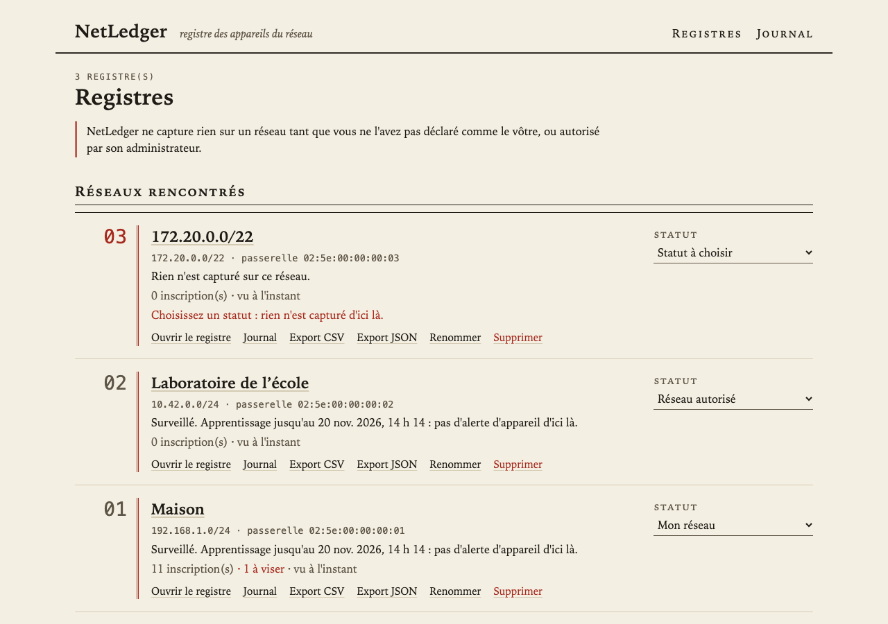
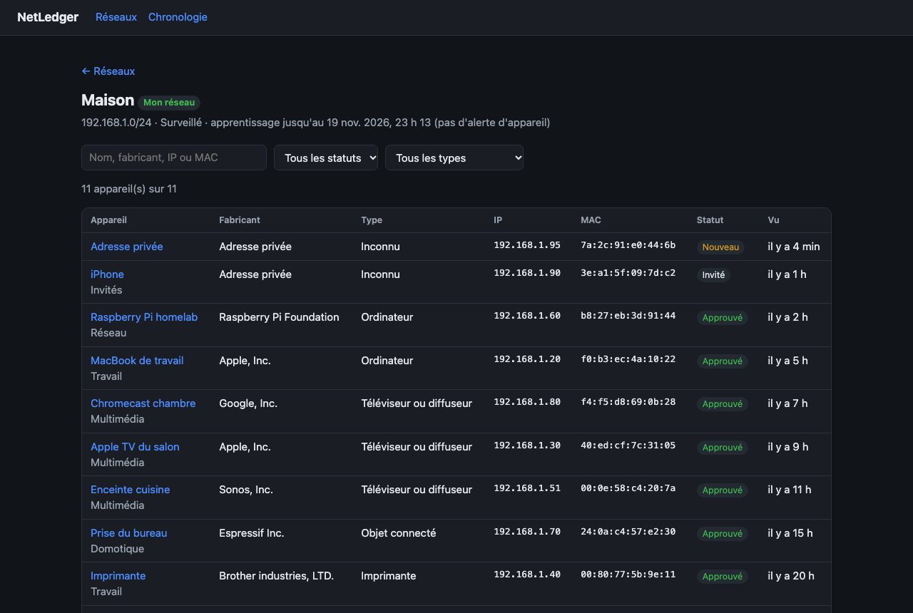
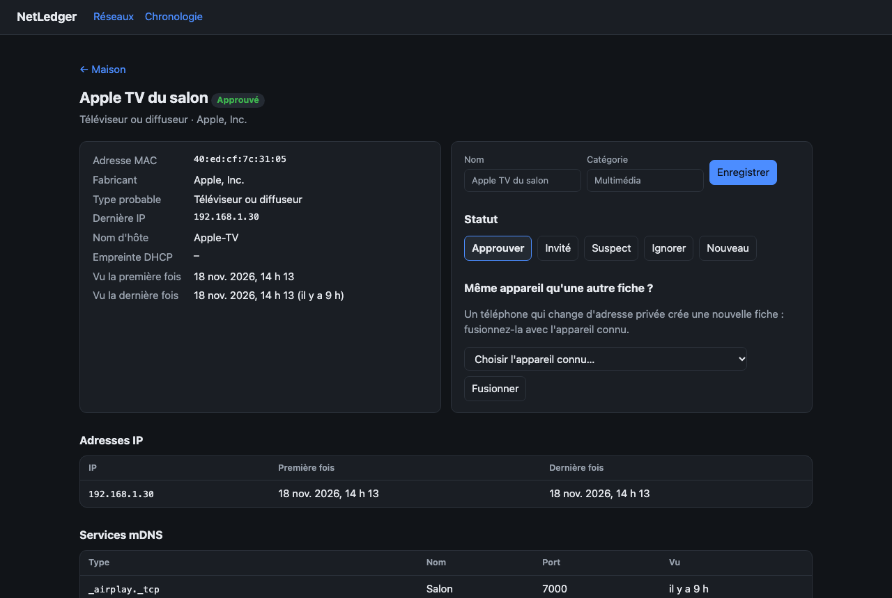
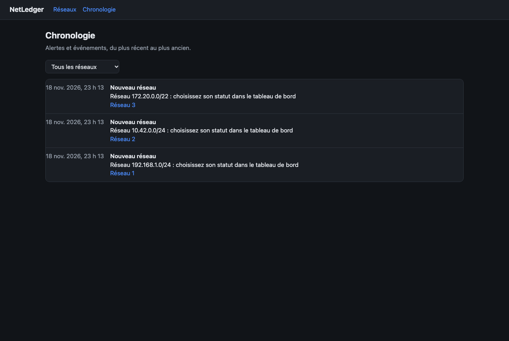
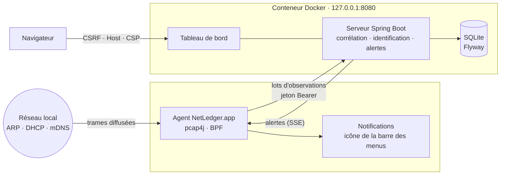

# NetLedger

*[English version](README.en.md)*

NetLedger tient le registre des appareils présents sur le réseau auquel votre Mac est connecté. Il écoute le trafic ARP, DHCP et mDNS, identifie le fabricant et le type probable de chaque appareil, garde l'historique par réseau et vous prévient quand un appareil inconnu apparaît.

> [!WARNING]
> **Réseaux autorisés seulement.** NetLedger ne capture rien tant que vous n'avez pas déclaré le réseau comme le vôtre (« Mon réseau ») ou autorisé par son administrateur (« Réseau autorisé »). Écouter un réseau sans autorisation peut être illégal. NetLedger est un outil défensif : écoute passive, aucun balayage de ports, aucune interception, aucune usurpation ARP, aucun paquet complet enregistré. Le balayage ARP actif est désactivé par défaut et réservé à « Mon réseau ».

## Le problème

Un réseau domestique compte des dizaines d'appareils : téléphones, ordinateurs, téléviseurs, imprimantes, prises connectées, appareils des invités. Le routeur en montre une liste partielle, sans historique ni alerte. On ne peut pas protéger un appareil dont on ignore l'existence. NetLedger fonctionne sur l'ordinateur qu'on utilise déjà, sans serveur dédié ni service en ligne.

## Captures

Les captures viennent du serveur de démonstration (`./scripts/demo.sh start`) : les noms et les adresses sont inventés.

| Réseaux et statut | Appareils d'un réseau |
| --- | --- |
|  |  |

| Fiche d'appareil | Chronologie |
| --- | --- |
|  |  |

## Architecture



**Pourquoi un agent natif et un serveur Docker ?** Docker Desktop exécute les conteneurs dans une machine virtuelle Linux. Même en mode réseau hôte, un conteneur partage le réseau de cette machine virtuelle, pas la carte Wi-Fi du Mac : il ne voit jamais les trames ARP, DHCP et mDNS du réseau local, et il ne peut pas afficher de notification macOS. Le travail est donc partagé :

- **l'agent** (module `agent`) est volontairement minimal : il capture, décode, reconnaît le réseau courant, envoie des observations normalisées et affiche les alertes. Il ne s'exécute jamais en administrateur ;
- **le serveur** (module `server`) porte toute la logique métier et il est le seul à écrire dans la base ;
- **le module `core`** est partagé : modèle `Observation`, décodeurs, format JSON d'échange.

Cette séparation capteur et serveur limite la partie qui a besoin de privilèges, comme dans les outils de sécurité professionnels.

## Protocoles

L'agent ne lit que les champs utiles. Le filtre BPF du noyau ne lui transmet que `arp or (udp and (port 67 or port 68 or port 5353))`, en mode non promiscuité.

- **ARP (RFC 826)** : chaque appareil qui demande ou annonce une adresse IP révèle le couple MAC et IP. Les annonces « gratuitous ARP » et les sondes RFC 5227 suffisent à repérer un appareil qui arrive. Une IP réservée (la passerelle, ou un appareil approuvé dans les dernières 24 h) annoncée par une autre MAC déclenche une alerte de conflit, signe classique d'une usurpation ARP.
- **DHCP (RFC 2131)** : l'en-tête BOOTP, puis les options après le « magic cookie » : 12 (nom d'hôte), 53 (type de message), 55 (liste des paramètres demandés, qui sert d'**empreinte** du système), 60 (classe du fabricant) et 61 (identifiant client). Un iPhone qui revient sur un réseau connu peut ne pas refaire de DHCP (DNAv4, RFC 4436) : ARP et mDNS prennent le relais.
- **mDNS et DNS-SD (RFC 6762, 6763)** : les enregistrements PTR, SRV, TXT, A et AAAA annoncent les services (`_airplay._tcp`, `_ipp._tcp`…). Le décodeur protège la décompression des noms : pointeurs uniquement vers l'arrière, 16 sauts au plus, noms de 255 octets au plus. L'agent pose seulement des questions mDNS (l'énumération des types de services, puis quelques types qui identifient un appareil : AirPlay, Cast, imprimantes), sans rien annoncer : une bibliothèque mDNS complète aurait publié le nom du Mac sur le réseau.

**Identification** : le fabricant vient du registre IEEE (MA-L, MA-M, MA-S, plus long préfixe). Une adresse dont le bit « administrée localement » est à 1 est une **adresse privée** aléatoire : NetLedger affiche « Adresse privée » plutôt qu'un fabricant. Le type probable suit des règles déterministes, documentées dans [docs/identification.md](docs/identification.md).

## Sécurité

- **Agent sans privilèges** : accès aux périphériques `/dev/bpf*` par le groupe `access_bpf`, comme Wireshark. Jeton rangé dans le trousseau macOS.
- **Serveur isolé** : port publié sur `127.0.0.1` uniquement, utilisateur non root, système de fichiers en lecture seule, aucune capacité Linux, `no-new-privileges`, 300 Mo de mémoire au plus.
- **API de l'agent** : jeton `Bearer` comparé en temps constant (empreintes SHA-256 et `MessageDigest.isEqual`), corps limités à 2 Mo, erreurs sans détails internes.
- **Tableau de bord** : jeton CSRF lié à la session, cookie `SameSite=Strict`, refus des requêtes dont l'en-tête `Host` n'est pas une adresse de bouclage (contre le DNS rebinding), politique de sécurité du contenu stricte (`script-src 'self'`). Les noms d'hôte venus du réseau sont affichés comme du texte, jamais comme du HTML, et neutralisés dans l'export CSV pour qu'un tableur ne les exécute pas comme formules.
- **Aucune IA, aucun service en ligne** : seule exception, le registre IEEE des fabricants, téléchargé une fois par mois par le serveur.

## Installation

Prérequis : un Mac Apple Silicon sous macOS 13 ou plus récent, Docker Desktop, et un JDK 21 pour construire l'agent.

1. **Accès à la capture**, une seule fois : `brew install --cask wireshark-chmodbpf`, puis fermez et rouvrez votre session. Votre compte rejoint le groupe `access_bpf`.
2. **Jeton partagé et serveur** :
   ```bash
   ./scripts/generate-token.sh
   docker compose up -d
   ```
3. **Jeton dans le trousseau** : `./scripts/install-agent-token.sh` (collez le jeton du fichier `.env`).
4. **Agent** : `./scripts/package-agent.sh` produit `agent/target/dist/NetLedger-1.0.0.dmg`. Ouvrez-le et glissez NetLedger dans Applications.
5. **Lancement** : ouvrez NetLedger. Aucune fenêtre ne s'ouvre : l'app démarre l'agent comme service utilisateur `launchd` (sans droits administrateur), et un point apparaît dans la barre des menus. **Quitter NetLedger** dans ce menu arrête l'agent jusqu'à la prochaine ouverture ; rien ne démarre seul à l'ouverture de session. macOS peut demander que « java » accède au réseau local : il sert à la requête mDNS. Une app construite sur votre Mac n'est pas bloquée par Gatekeeper ; un `.dmg` téléchargé l'est, il faut alors cliquer **Ouvrir quand même** dans **Réglages Système › Confidentialité et sécurité**.
6. **Assistant** : au lancement, l'agent vérifie l'accès BPF, l'accès au réseau local, le jeton et le serveur, et explique quoi faire si un point manque. On peut le rouvrir avec **Vérifier l'installation** dans le menu. Journal de l'agent : `~/Library/Logs/NetLedger/agent.log`.
7. **Statut du réseau** : ouvrez [http://127.0.0.1:8080](http://127.0.0.1:8080) et choisissez le statut du réseau courant. Sans réponse, rien n'est capturé. Les 24 premières heures de surveillance sont une période d'apprentissage, sans alerte d'appareil.

Pour essayer le tableau de bord sans réseau ni agent : `./scripts/demo.sh start`, puis [http://127.0.0.1:8081](http://127.0.0.1:8081).

**Désinstaller** : quittez NetLedger depuis son menu, puis :

```bash
launchctl bootout gui/$(id -u)/io.github.chakibselhi.netledger.agent
rm ~/Library/LaunchAgents/io.github.chakibselhi.netledger.agent.plist
rm -r /Applications/NetLedger.app ~/Library/Logs/NetLedger "$HOME/Library/Application Support/NetLedger"
security delete-generic-password -s NetLedger -a agent
docker compose down -v
```

### Pourquoi l'app passe par `launchd`

Depuis macOS 15, le système cache le réseau local aux programmes qu'il n'a pas autorisés : lancée par l'app, la commande `arp` répondait « no entry » pour le routeur alors que l'entrée existait. Les essais ont montré que ce masquage visait les exécutables signés seulement en local (« ad hoc »), et que l'interrupteur « Réseau local » des Réglages ne le levait pas pour eux. Le lanceur `java` du JDK, signé par son éditeur (Adoptium), n'est pas concerné. L'app embarque donc ce `java` d'origine et le fait démarrer par `launchd`, hors de l'identité de l'app. Le script de packaging garde cette signature : il ne re-signe que l'enveloppe de l'app et construit le `.dmg` avec `hdiutil`, car `jpackage --type dmg` la remplaçait.

## Développement

```bash
mvn verify
```

Java 21, Maven multi-modules (`core`, `agent`, `server`), JUnit 5 et AssertJ. Les décodeurs sont testés sur de vraies captures PCAP anonymisées (`core/src/test/resources/pcap`). JaCoCo exige 80 % de couverture des lignes sur `core` et sur la corrélation, l'identification et les alertes du serveur. Spotless (google-java-format) vérifie le format. GitHub Actions exécute les tests et construit l'image Docker.

## Limites connues

- **Ce qu'une machine voit** : sur un réseau commuté ou en Wi-Fi, un ordinateur ne reçoit que le trafic diffusé et le sien. ARP, DHCP et mDNS sont justement diffusés, mais un appareil silencieux peut rester invisible, sauf si le balayage ARP (réseau « Mon réseau » seulement) est activé.
- **Isolation des clients** : beaucoup de réseaux publics ou d'entreprise empêchent les appareils de se voir. L'inventaire y est incomplet.
- **Adresses privées** : un téléphone peut changer d'adresse MAC. NetLedger rapproche les fiches par nom d'hôte et empreinte DHCP, et propose une fusion manuelle.
- **Notifications** : l'agent les affiche avec `osascript`. Sur certaines configurations de macOS, elles n'apparaissent pas. L'icône de la barre des menus et son menu « Dernières alertes » restent alors la référence.
- **Application non signée** par un compte développeur Apple : confirmation demandée au premier lancement.
- **Un seul agent**, IPv4 seulement. Démarrage à l'ouverture de session, SSDP, plusieurs agents et IPv6 sont prévus pour plus tard.
