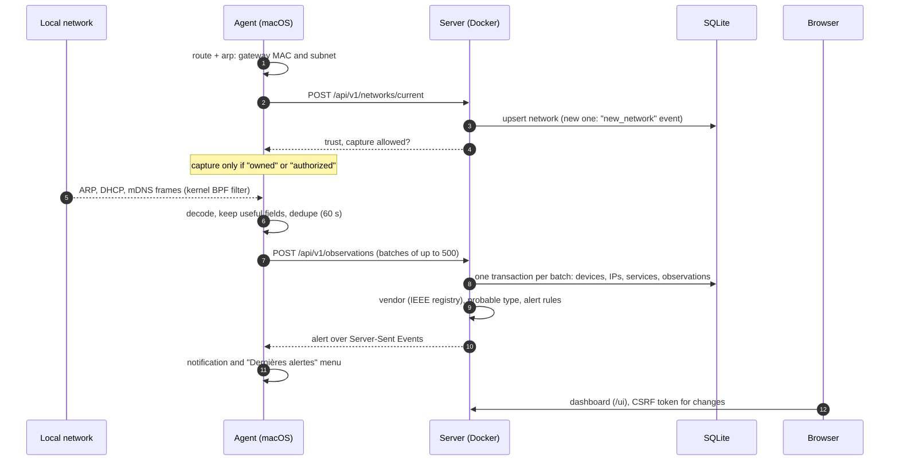
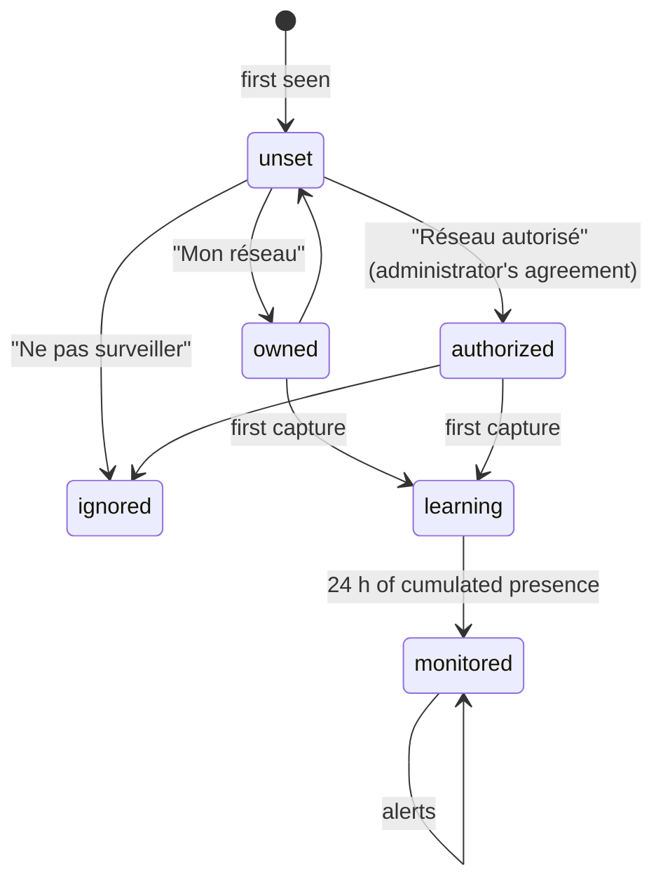

# Architecture

NetLedger is split into a small native sensor and a server that holds all the logic. This document follows an observation from the wire to the dashboard, then explains the design decisions and the threat model.

## Modules

| Module | Runs | Main packages |
| --- | --- | --- |
| `core` | Library shared by both sides | `model` (`Observation`, `ServiceAnnouncement`), `decode` (ARP, DHCP, DNS/mDNS decoders), `pcap` (reader, writer, anonymizer for test fixtures), `json` |
| `agent` | Natively on macOS, started by `launchd` | `capture` (pcap4j), `network` (current network), `buffer`, `server` (HTTP client), `alerts` (SSE client, notifications), `ui` (menu bar, setup window), `setup`, `launch` |
| `server` | Docker container | `network` (networks and trust), `correlation` (single writer), `identification` (vendor and type), `alerting` (rules, SSE), `dashboard`, `api`, `config` (security), `persistence` |

## From the wire to the dashboard

1. **Network detection.** Every 10 seconds the agent reads the default route and the gateway's ARP entry. A network is identified by the pair (gateway MAC, subnet), so two homes using `192.168.1.0/24` stay distinct.
2. **Decision.** The server answers with the trust the user chose. A new network is stored as "unset" and raises a silent "new network" alert asking the user to choose. Without an answer, nothing is captured.
3. **Capture.** libpcap through pcap4j, non-promiscuous, with the kernel filter `arp or (udp and (port 67 or port 68 or port 5353))`: the agent never receives any other traffic.
4. **Decoding.** `core` decoders turn frames into `Observation` records (MAC, IP, host name, DHCP fingerprint, vendor class, mDNS services). The raw frame is dropped right away.
5. **Buffer.** Bounded to 10,000 observations, identical ones within 60 seconds merged. When the server is down, batches wait and are retried with a backoff up to 5 minutes.
6. **Correlation.** The server applies each batch in one transaction, under one lock: it is the only writer. Batches may arrive late and out of order, so an older observation only fills empty fields and never overwrites a newer value.
7. **Identification and alerts.** Vendor by longest IEEE prefix, probable type by deterministic rules ([identification.md](identification.md)), then the alert rules.
8. **Delivery.** Connected agents get alerts over SSE. Alerts raised while no agent listened are delivered at the next connection, merged into one summary when there are more than three.

## Network lifecycle

The learning period counts presence, not calendar time: when the agent comes back after more than 5 minutes away, the end of the period moves forward by the absence. During it, devices are recorded without "new device" alerts.

## Design decisions

| Decision | Why |
| --- | --- |
| Native agent and Docker server | Docker Desktop runs containers in a Linux VM: even with host networking, a container sees the VM's network, never the Mac's Wi-Fi frames, and cannot show a macOS notification. |
| The server is the only writer | SQLite allows one writer at a time. A single lock plus one transaction per batch keeps devices, IP history and events consistent, and alerts are stored with the observation that caused them. |
| Fixed-width UTC timestamps (`2026-11-18T12:00:00.000Z`) | String order equals time order, so SQL `MIN`, `MAX` and `ORDER BY` work on text without parsing. |
| `pcap_next_ex`, not `pcap_next` | Apple's libpcap adds a 256-byte `comment` field to `struct pcap_pkthdr`. pcap4j allocates the 24-byte header of other platforms, so `pcap_next` overflowed the heap on every packet (a crash in `malloc`). `pcap_next_ex` returns a pointer to libpcap's own header instead. |
| A raw mDNS query instead of JmDNS | JmDNS announces the Mac's own host name on the network as soon as it starts. The agent only needs to ask: one PTR query for `_services._dns-sd._udp.local`, then a few identifying types. |
| Proxies count only their own services | An Amazon Echo acting as a Thread border router (RFC 8766 discovery proxy) listed 25 service types of other devices and was classified as a printer. For proxies, only services backed by an instance of their own count. |
| Server-Sent Events | One long-lived HTTP response from server to agent: no polling, works through the same token-protected API, reconnects simply. A heartbeat every 25 seconds keeps it open. |
| Sleep detection from the wall clock | Java has no sleep event. The control loop ticks every 5 seconds; a gap above 60 seconds means the Mac slept, so capture stops and the network is detected again. |
| `launchd` and the vendor-signed `java` | Since macOS 15, the system hides the local network (here the gateway's ARP entry) from programs it has not allowed. For an ad-hoc signed app, allowing it in System Settings did not lift it. The JDK's own `java` launcher, signed by Adoptium, is not hidden, so NetLedger.app has `launchd` run the agent with that binary. The packaging script keeps its signature (no `codesign --deep`, `.dmg` built with `hdiutil`). |
| Notifications with `osascript` | `TrayIcon.displayMessage` shows nothing for an unbundled Java process. The message is passed as an argument (`on run argv`), never spliced into AppleScript source, so a hostile device name cannot inject a script. |

## Threat model

| Adversary | What they could try | Protection |
| --- | --- | --- |
| A device on the local network | Hostile host or mDNS names (`<script>`, `=HYPERLINK(...)`), malformed frames, compression loops | Decoders bound every read, follow DNS compression pointers backward only, at most 16 jumps, names of 255 bytes at most, and strip control characters. The dashboard renders text nodes only, never HTML. The CSV export prefixes formula characters with an apostrophe. Notifications pass text as AppleScript arguments. |
| A web page open in the user's browser | Send requests to `127.0.0.1:8080` (CSRF), or rebind its own DNS name to `127.0.0.1` to read answers | Session-bound CSRF token on every change, `SameSite=Strict` cookie, requests whose `Host` is not a loopback name refused with 421, strict Content Security Policy (`script-src 'self'`, `frame-ancestors 'none'`). |
| Another machine on the network | Reach the API or the dashboard | Port published on `127.0.0.1` only. The agent API needs the shared bearer token, compared on SHA-256 digests with `MessageDigest.isEqual` (constant time). |
| A misbehaving or compromised agent | Huge bodies, future timestamps, authorizing its own network | 2 MB body limit, 411 when the length is unknown, observations validated (clock skew, MAC format), batch size limit. The agent API cannot change a network's trust: only the dashboard can. |
| The container itself | Escalate if a dependency is compromised | Non-root user, read-only root file system, all Linux capabilities dropped, `no-new-privileges`, `/tmp` mounted `noexec`, 300 MB memory limit. |

What NetLedger does **not** protect against: someone already running code as the same macOS user, who can read the keychain item and the `.env` file.

## Testing

- **Real captures, anonymized.** The decoders are tested against PCAP files recorded on a home network. `PcapAnonymizer` rewrites MAC addresses, IP addresses and names while keeping lengths and UDP checksums valid, then checks that no original value is left, including length-prefixed DNS labels.
- **Robustness.** Every truncation of every real frame, and random corruptions of them, must be handled without any exception escaping the decoders; random bytes parsed as a DNS message may only raise `MalformedPacketException`.
- **Server.** Spring Boot tests on a temporary SQLite database: correlation, alert rules, SSE delivery, API and dashboard security (CSRF, Host check, CSP), merge and export. An end-to-end test feeds a whole capture and checks the inventory.
- **Agent.** Control loop with a fake clock (sleep, network change, backoff), buffer, SSE parsing, setup checks, launchd job installation with a fake `launchctl`.
- **Coverage.** JaCoCo requires 80 % of lines on `core` and on the server's correlation, identification and alerting.
